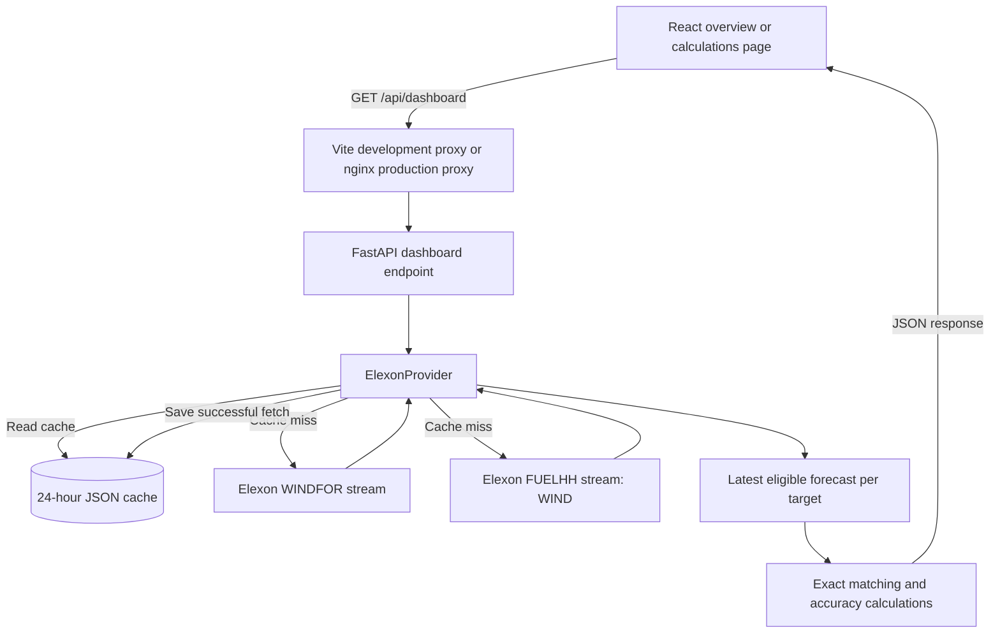

# Windwise

Windwise is a React and FastAPI dashboard for exploring historical wind-generation forecasts and evaluating them against recorded actual generation. It supports UK day-ahead electricity purchasing decisions using national wind data from Elexon.

Choose a decision date in January 2026 and an information cutoff. The application selects the forecasts available by that moment for the next delivery day, compares matching target timestamps, and explains the daily results.

Quick navigation: [Access](#access-the-project) · [Local setup](#run-locally) · [Docker](#run-with-docker) · [Architecture](#architecture) · [Calculations](#accuracy-calculations) · [File structure](#files-and-directories) · [Deployment](#deployment-preparation) · [Submission](#assignment-submission).

## Access the project

| Access method | URL | Status |
| --- | --- | --- |
| Public application | **Pending deployment — add the verified Vercel or Heroku URL here before submission** | Not deployed yet |
| Deployed backend documentation | [FastAPI API documentation](https://djntjfiigtvnigj.vercel.app/docs) | Backend deployed; frontend pending |
| Local development | [http://localhost:5173](http://localhost:5173) | Requires frontend and backend servers |
| Local Docker | [http://localhost:8080](http://localhost:8080) | Requires Docker Compose |
| Backend API documentation | [http://localhost:8000/docs](http://localhost:8000/docs) | Requires backend server |

No login or Elexon API key is required. Localhost links work only on the computer running the services; they are not public submission links.

Start on the overview, choose a date and cutoff, then select **View all calculations** to inspect the full table. The date and cutoff stay in the URL across page navigation and reloads.

## Features

- **January decision dates:** January 1–31, 2026. Delivery is the following calendar day, including February 1 for a January 31 decision.
- **Cutoff control:** every 30 minutes from 00:00 to 23:30. The initial default is 11:00; it is not a claimed official market deadline.
- **Real Elexon data:** WINDFOR predictions and FUELHH actuals filtered to WIND. The application never falls back to synthetic values.
- **Daily summary:** peak selected forecast, mean absolute error, signed forecast bias, and half-hour grid match.
- **Comparison chart:** hourly forecast samples and half-hourly actuals, hover details, and an actual-generation visibility toggle.
- **Complete calculations:** 48 delivery slots, the selected four-field forecast message, actuals, signed and squared errors, matched/excluded status, and totals.
- **Formula tooltips:** hover, keyboard-focus, or tap metric labels and error headings. Escape dismisses the custom tooltip.
- **CSV export:** all 48 records, including forecast/actual values, errors, publication times, and data source. Missing values stay blank.
- **Request feedback:** loading states, retrieval time, cache status, and retry controls.
- **Responsive interface:** mobile layouts and a scrollable detailed table.

Summary metrics describe the selected delivery day, not the whole month. The project evaluates existing forecasts; it does not train a forecasting model, execute trades, or calculate a utility's exact purchasing requirement.

## Technology stack

| Layer | Technology | Purpose |
| --- | --- | --- |
| Frontend | React 19, JavaScript | Filters, navigation, chart, tables, and exports |
| Charts and icons | Recharts, Lucide React | Data visualization and interface icons |
| Frontend tooling | Vite | Development server, API proxy, and production build |
| Backend | Python, FastAPI, Uvicorn | HTTP routes, validation, and dashboard responses |
| Source access | HTTPX | Elexon requests, timeouts, and error handling |
| Cache | JSON files | Reuse normalized data for 24 hours |
| Production frontend | nginx | Static serving, API proxy, and deep-link fallback |
| Containers | Docker and Docker Compose | Package and run both services |
| Tests | pytest, TestClient, MockTransport | Repeatable backend checks without real API calls |

There is no database or authentication service. Synthetic data is retained only for test fixtures.

## Run locally

### Prerequisites

- Git, to clone the public repository (or download and extract its ZIP instead).
- Python 3.10+; the backend Docker image uses Python 3.12.
- Node.js 22.12+ recommended, with npm. The frontend image uses Node 22.
- Backend internet access to data.elexon.co.uk for uncached requests.

### Get the source code

Clone the public GitHub repository:

```bash
git clone https://github.com/adevansh078/djntjfiigtvnigj.git windwise-source
cd windwise-source
cd wind-dashboard
```

These steps assume the repository keeps the current wind-dashboard/ subfolder. If the project contents are published directly at the repository root, omit the final cd wind-dashboard command.

You are now in the project folder containing README.md, compose.yaml, backend/, and frontend/. Run the following instructions from this folder. For each second terminal, navigate to this same project folder before running its commands; opening a new terminal does not automatically put it in the first terminal's directory.

If you downloaded a ZIP, extract it, open a terminal in the folder containing this README, and continue below.

### Windows PowerShell

Backend, in the first terminal:

```powershell
cd backend
python -m venv .venv
.\.venv\Scripts\python.exe -m pip install -r requirements.txt
.\.venv\Scripts\python.exe -m uvicorn app.main:app --reload --host 127.0.0.1 --port 8000
```

Frontend, in a second terminal starting from the project folder:

```powershell
cd frontend
npm ci
npm run dev
```

Open [http://localhost:5173](http://localhost:5173). Keep both terminals running. Stop each service with Ctrl+C.

After installing dependencies once, both services can also be started from the project folder with:

```powershell
powershell -ExecutionPolicy Bypass -File .\start.ps1
```

The script starts the backend in a hidden process, writes backend/server.log and backend/server-error.log, and runs the frontend in the terminal. Ctrl+C triggers cleanup of the backend it started. Stop previous server instances first to avoid port conflicts.

### macOS or Linux

Backend:

```bash
cd backend
python3 -m venv .venv
.venv/bin/python -m pip install -r requirements.txt
.venv/bin/python -m uvicorn app.main:app --reload --host 127.0.0.1 --port 8000
```

Frontend, in a second terminal starting from the project folder:

```bash
cd frontend
npm ci
npm run dev
```

### Frontend production build

From frontend/:

```bash
npm run build
```

Assets are written to frontend/dist/. The built frontend still needs a production API proxy. Vite's development proxy is not included in static assets; running npm run preview alone does not reproduce the full container routing setup.

## Run with Docker

Install Docker with Compose support and start its engine. From the project folder:

```bash
docker compose up --build
```

- Dashboard: [http://localhost:8080](http://localhost:8080)
- Backend docs: [http://localhost:8000/docs](http://localhost:8000/docs)
- Proxied health check: [http://localhost:8080/api/health](http://localhost:8080/api/health)

Stop both services:

```bash
docker compose down
```

The backend image installs Python dependencies and starts Uvicorn on port 8000. The frontend image builds React in a Node stage and copies the build into nginx, listening on container port 80. Compose exposes nginx on host port 8080.

nginx forwards /api/ to http://backend:8000 over the Compose network. Other routes fall back to index.html, allowing direct access to /calculations. The /docs route is available on backend port 8000; it is not forwarded by the frontend's /api/ rule.

Current Compose configuration has no persistent cache volume or backend readiness check. Files survive a process restart on the same filesystem but may be lost when the container is removed. Configuration has been checked; container runtime verification is still needed because Docker's engine was unavailable during development.

## Architecture



### Frontend

App.jsx initializes decision date and cutoff from URL query parameters, manages request state, and fetches /api/dashboard. Filter changes update the URL and request another result. An AbortController cancels the preceding browser request when filters change.

Both pages use the same React entry point. The pathname selects overview at / or details at /calculations. Navigation uses ordinary links, not a routing library. Links preserve decision_date and cutoff. The frontend server must return index.html for deep links.

Calculations.jsx renders all backend-selected points and computes row-level errors, squared errors, and totals from the same values. Aggregate metrics come from the backend. Each displayed forecast message represents the selected record's dataset, publishTime, startTime, and generation fields with normalized UTC timestamps. It is not an entire publication batch or an additional API request.

FormulaHint.jsx implements reusable tooltip interactions. CSV exports are created in the browser from the current response.

### Backend

main.py validates inputs, constructs the cutoff and next delivery day, obtains source records through dependency injection, assembles the 48-slot grid, and returns metrics and provenance.

elexon.py owns upstream requests, timeouts, retries, normalization, filtering, actual revisions, and cache operations. forecast.py separately owns cutoff selection and source-independent metric calculations. This separation allows tests to replace the provider and verify calculations without public network access.

### Architecture scope

This structure is designed for a small assignment application: the UI handles presentation, the backend owns data retrieval and selection, and calculation functions stay independently testable. A database or additional service is not required for this bounded historical dataset.

The file cache and process-level lock are intentionally simple. They are not shared storage or distributed coordination for multiple backend instances. Production hosting still needs the platform-specific API proxy, port configuration, and cold-start/deep-link checks described below. The architecture description is not a claim that those deployment tasks have already been completed.

### Request flow

1. The browser sends a decision date and cutoff, for example January 10 at 11:00.
2. FastAPI constructs the cutoff in UTC and sets delivery to January 11.
3. The provider checks the decision-date cache. An unexpired entry avoids upstream requests.
4. On a cache miss, WINDFOR is fetched for seven publication days ending at midnight after the decision day. For January 10, this is January 4 through January 11. Prior-day publications are included for early cutoffs.
5. FUELHH is fetched for the delivery settlement date with fuelType=WIND. WIND is also checked locally.
6. Timestamps are normalized to UTC and records outside the delivery day are discarded. Malformed and non-finite records are excluded. For duplicate actual timestamps, the latest valid returned publication is retained.
7. For each target, choose the greatest publishTime satisfying publishTime <= cutoff.
8. Match forecasts and actuals by identical startTime, retaining all 48 grid slots.
9. Calculate metrics from matched pairs and return the result and source metadata.

The seven-day lookback is bounded; it is not a search over every historic publication. The provider lock prevents simultaneous cache-miss fetches within one process, not across multiple workers or servers.

## Forecast selection and time interpretation

| Term | Meaning |
| --- | --- |
| Decision date | The day the buyer makes the purchasing decision |
| Cutoff | Latest permitted forecast publication time |
| Delivery day | Next calendar day after the decision |
| publishTime | When a forecast record was published |
| startTime | The generation target predicted or measured |
| generation | Power in MW |

Times are UTC. UK local time is UTC throughout the January and early-February dates covered here. The fixed 48-slot grid is scoped to those dates, not a general daylight-saving-time implementation.

For a January 10 cutoff of 11:00 and a January 11 target of 16:00:

| Publication on January 10 | Target on January 11 | Forecast | Selection |
| --- | --- | --- | --- |
| 07:30 | 16:00 | 20,203 MW | Eligible but superseded |
| 09:30 | 16:00 | 20,248 MW | Latest eligible |
| 11:30 | 16:00 | 20,215 MW | After cutoff; excluded |

These values were verified against Elexon during development. A publication can contain multiple records for different target times, so publication timestamps may repeat across table rows. Selection is performed independently for each target.

The initial cutoff of 11:00 is a UI default, not an asserted official market deadline. Users can explore any provided cutoff.

## Hourly forecasts and half-hourly actuals

FUELHH has half-hourly actuals. A January WINDFOR audit found 18,104 records across 248 publication times: all target timestamps were on the hour, with no :30 targets. Consecutive targets within publications were 60 minutes apart. Elexon's [wind generation page](https://bmrs.elexon.co.uk/wind-generation) also describes hourly forecasting.

Windwise does not interpolate, forward-fill, or synthesize intermediate forecasts. It compares an hourly target with the actual at the identical start timestamp, not an averaged whole-hour actual. Results are exact-timestamp comparisons, not evaluations of every half-hour or total daily energy.

When 24 hourly targets have matching actuals, Half-hour grid match is 24 / 48 = 50%. This does not mean 50% accuracy or that half the source is missing. Unmatched rows stay visible but are excluded from error averages.

## Accuracy calculations

For selected forecast F_i, actual A_i, and N matched timestamps:

```text
Signed error_i = F_i - A_i
MAE            = sum(abs(F_i - A_i)) / N
Bias           = sum(F_i - A_i) / N
RMSE           = sqrt(sum((F_i - A_i)^2) / N)
Peak forecast  = max(available selected forecasts)
Grid match %   = N / 48 * 100
```

- Positive error/bias means overestimated wind; negative means underestimated wind.
- MAE, bias, RMSE, and peak forecast use MW. Squared error uses MW². These are not MWh or trading-cost calculations.
- Missing values are not zero. A genuine zero-generation observation remains valid.
- With no matched pairs, error averages are null and displayed as a dash.
- Aggregate backend metrics are rounded to one decimal place. Overview cards show whole numbers for readability; detailed values can show extra decimals. Calculations use underlying values.
- RMSE is returned by the backend and explained in the squared-error heading tooltip; it is not a separate overview card.
- Actual revisions are used retrospectively and are not restricted by the purchasing cutoff.

## Elexon integration and cache

Base URL: https://data.elexon.co.uk/bmrs/api/v1

| Dataset endpoint | Parameters | Purpose |
| --- | --- | --- |
| /datasets/WINDFOR/stream | publishDateTimeFrom, publishDateTimeTo | Historical forecast publications |
| /datasets/FUELHH/stream | settlementDateFrom, settlementDateTo, fuelType=WIND | Delivery-day actuals |

Requests use a 10-second connection timeout and 30-second read/write/pool timeouts. Network failures, rate limits (429), and server errors (5xx) receive up to three attempts. Unexpected response structures and unrecoverable upstream errors return HTTP 502. There is no fallback to synthetic data or expired cached data.

Successful normalized records are cached for 24 hours under backend/.cache/elexon/, keyed by decision date. Different cutoffs reuse these records and reselect eligible predictions. Cache writes use a temporary file followed by replacement. A cache-write failure does not prevent serving successfully fetched data.

The API includes warning/missing counts and source metadata. The UI shows unmatched rows and source/cache information; the yellow warning banner was intentionally removed. The API response retains its complete warning list.

### Environment settings

| Variable | Used by | Default |
| --- | --- | --- |
| ELEXON_CACHE_DIR | Backend | backend/.cache/elexon/ locally; /app/.cache/elexon/ in its container |
| API_PROXY_TARGET | Vite development server | http://127.0.0.1:8000 |

Set environment variables before starting the appropriate service. The backend does not automatically load a .env file. There is no implemented VITE_API_URL setting. Elexon requests require no credentials.

## Application API

### GET /api/health

Returns service status, data_source: "elexon", and upstream_checked: false. This checks the application process, not Elexon connectivity.

### GET /api/dashboard

Example:

```text
/api/dashboard?decision_date=2026-01-10&cutoff=11%3A00
```

| Parameter | Default | Validation |
| --- | --- | --- |
| decision_date | 2026-01-10 | ISO date in January 2026 |
| cutoff | 11:00 | Clock time without a timezone offset; minute-level values such as 10:45 accepted |

The UI offers half-hour choices; the API also accepts finer cutoffs.

The response contains decision/delivery dates, cutoff, data source, retrieval time, cache status, publication window, warnings, missing counts, metrics, and 48 records. Example point:

```json
{
  "startTime": "2026-01-11T16:00:00+00:00",
  "forecast": 20248.0,
  "actual": 15755.0,
  "publishTime": "2026-01-10T09:30:00+00:00",
  "error": 4493.0
}
```

Invalid inputs return HTTP 422; external-data failures return HTTP 502. Open /docs for interactive API documentation or /openapi.json for its schema on the backend.

## Files and directories

```text
wind-dashboard/
  README.md                       Setup, features, architecture, assumptions
  compose.yaml                    Two-service local container configuration
  start.ps1                       Windows launcher for both development servers
  .gitignore                      Excludes environments, caches, builds, logs
  backend/
    Dockerfile                    Python image and Uvicorn startup
    .dockerignore                 Excludes environments and cached data
    requirements.txt              Runtime and testing dependencies
    app/
      __init__.py                 Python package marker
      main.py                     Routes, validation, dashboard assembly
      services/
        __init__.py               Service package marker
        elexon.py                 HTTP provider, normalization, retries, cache
        forecast.py               Selection logic and accuracy calculations
        sample_data.py            Synthetic fixtures used only by tests
    tests/
      test_forecast.py            Cutoff, per-target selection, metrics, validation
      test_elexon.py              Mocked source, normalization, cache, failures
  frontend/
    Dockerfile                    Node build and nginx serving stages
    .dockerignore                 Excludes dependencies and generated builds
    nginx.conf                    Static serving, API proxy, deep-link fallback
    package.json                  Dependencies and scripts
    package-lock.json             Locked frontend dependency tree
    index.html                    Browser entry document
    vite.config.js                React tooling and development API proxy
    vercel.json                   Production API proxy and frontend deep-link routing
    src/
      main.jsx                    React entry point
      App.jsx                     Layout, controls, fetch, overview, CSV export
      Calculations.jsx            Full table, selected messages, errors, totals
      FormulaHint.jsx             Formula tooltip interactions
      styles.css                  Shared responsive styling
      calculations.css            Table, navigation, and tooltip styling
```

.venv/, node_modules/, dist/, .cache/, and logs are generated locally and excluded from version control.

## Verification

From backend/ on Windows:

```powershell
.\.venv\Scripts\python.exe -m pytest -q
```

On macOS/Linux:

```bash
.venv/bin/python -m pytest -q
```

From frontend/:

```bash
npm run build
```

Eight backend tests cover cutoff exclusion, independent per-target selection, zero/missing handling, the January-to-February boundary, validation, timestamp normalization, actual revisions, caching, invalid responses, and upstream failures. Mocked HTTP makes them repeatable without external API access.

During development, real requests were checked for January 1 and January 31. Independently checking 144 slots across three January 10 cutoffs found no selection mismatches against raw records. Frontend builds passed. Browser automation was unavailable; a complete interactive visual acceptance check is still needed before submission.

## Deployment preparation

The FastAPI backend is deployed at https://djntjfiigtvnigj.vercel.app. Its health, documentation, OpenAPI schema, real-data dashboard request, and invalid-date handling were verified publicly. The public frontend URL is still pending. Docker Compose remains a separate local container setup.

The chosen arrangement uses two Vercel projects connected to the same GitHub repository:

1. Backend project root: wind-dashboard/backend. Use the FastAPI framework preset and set ELEXON_CACHE_DIR=/tmp/windwise-elexon. Vercel runs the FastAPI application through its Python runtime, not the Dockerfile or Compose. The temporary cache is disposable and not shared between instances.
2. Backend production URL: https://djntjfiigtvnigj.vercel.app. Verify /api/health, /docs, and a real /api/dashboard request after backend changes.
3. For Vercel, select frontend/ as project root, npm ci for installation, npm run build for building, and dist as output.
4. The committed frontend/vercel.json forwards /api/:path* to the deployed backend and falls back to index.html for frontend deep links. The API rule precedes the fallback. Update this file if the backend production domain changes.
5. Keep browser API calls same-origin through that proxy. Direct cross-origin backend calls would require frontend configuration and backend CORS support, neither of which is currently implemented.
6. Configure a writable cache directory. On ephemeral storage, caches are disposable; persistence is an optimization.
7. Verify overview, direct calculations links, date/cutoff changes, tooltips, CSV export, and a cold uncached request.
8. Replace the pending public URL at the top of this README with the verified HTTPS app link. Add the deployed API docs link if publicly exposed.

Platform references: [Vite on Vercel](https://vercel.com/docs/frameworks/frontend/vite), [Vercel rewrites](https://vercel.com/docs/routing/rewrites), and [Heroku Container Registry and Runtime](https://devcenter.heroku.com/articles/container-registry-and-runtime).

## Troubleshooting

| Symptom | Action |
| --- | --- |
| Dashboard cannot load data | Start backend on port 8000; check /api/health and logs |
| First request is slower | Both source datasets must be fetched before caching |
| HTTP 502 | Check backend internet access and Elexon availability, then retry |
| Port already in use | Stop an earlier server before launching another copy |
| Direct calculations URL gives 404 after hosting | Add the frontend SPA fallback to index.html |
| Deployed API fails but local works | Configure the production /api proxy; Vite's proxy is development-only |
| Grid match shows 50% | Hourly targets match 24 of 48 half-hour slots; this is not accuracy |
| Publication timestamp repeats | One batch contains several target-time records |
| Docker cannot reach its engine | Start Docker Desktop or the Docker daemon |
| Need fresh cached data | Remove the relevant JSON file from the configured cache directory and request that date again |

## Assignment submission

This README includes file/directory details and startup instructions. Add the live Vercel/Heroku application link after deployment.

Before submission, verify Docker on a running engine, publish the anonymous-name public repository, and record the mandatory unlisted YouTube video. The maximum video length is 10 minutes, with a customer presentation and technical review, each including an initial overview of at most 5 minutes. Evaluation starts with the video, so it must be included.

Verify every submitted link in incognito mode, then submit the repository, deployed application, video, and other requested details through the [assignment submission form](https://forms.cloud.microsoft/r/FTX6K2bbnU). The brief sets a maximum effort of 16 hours and no fixed submission deadline.

A separate monthly dashboard and interpolation are not explicitly required by the brief. The implemented interface evaluates one delivery day at a time within the January purchasing-decision scope.

## AI assistance and source attribution

**AI tools were used:** OpenAI Codex assisted with implementation, UI changes, testing, data inspection, and documentation. Forecast predictions and actuals come from Elexon, not AI. Synthetic data is retained only for test fixtures.

Data source: [Elexon Insights](https://bmrs.elexon.co.uk), using the specified [FUELHH stream](https://bmrs.elexon.co.uk/api-documentation/endpoint/datasets/FUELHH/stream) and [WINDFOR stream](https://bmrs.elexon.co.uk/api-documentation/endpoint/datasets/WINDFOR/stream) datasets. See the [BMRS data licensing terms](https://www.elexon.co.uk/bsc/data/balancing-mechanism-reporting-agent/copyright-licence-bmrs-data/) for attribution and reuse conditions.

